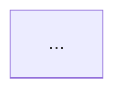

# PLAN.md — OSSO V2 : Companion Node · Agent Teacher · Section Apprentissage

> **Statut** : ⏳ EN ATTENTE DE VALIDATION — aucun code n'a été écrit.
> **Date de cadrage** : 29/10/2026
> **Plan précédent** (dashboard complet) : conservé dans `PLAN-2026-10-28-dashboard.md` et dans l'historique git (`72e9b63`). Il est **intégralement exécuté**.

---

## Contexte & besoin métier

Trois fonctionnalités, un même fil conducteur : **apprendre et agir en étant « agentic developer »**.

1. **Companion Node (tray Windows)** — processus discret en tâche de fond, démarrage automatique, qui **interroge l'API OSSO** toutes les 5–10 s et **exécute localement** les commandes (LEAD, rescan brain). Il **remplace le Local Bridge serveur** : c'est ce qui rendra OSSO utilisable **depuis Vercel**. Une **pastille de présence** sur le dashboard indique si tu peux lancer un prompt ou non.

2. **Agent `teacher`** — agent OpenCode **global** (disponible dans tous tes projets). Il détecte les technologies du projet courant, te propose une **liste à choix multiple** dans le terminal (excluant ce qui t'a déjà été expliqué ou que tu connais déjà), puis génère **un cours complet par technologie** écrit **en base**. Zéro fichier de cours sur disque.

3. **Section Apprentissage (dashboard)** — chaque cours devient une page **au design Graphite Chaud du dashboard**, rendue depuis le Markdown, avec un bouton **« J'ai fini »** qui bascule le statut en **Accompli**.

**Stack conservée** : Nuxt 4 · Tailwind v4 · Drizzle + **Supabase Postgres** · design system `app/assets/css/main.css` (thème sombre par défaut + clair).

---

## Questions / décisions en attente

**Une seule**, à confirmer au premier usage réel :

| # | Sujet | Proposition retenue |
|---|---|---|
| A | **Format de la base de connaissances du Teacher** | **Markdown strict** (`~/.osso/teacher-kb.md`), avec deux sections à puces dont le format est normé pour un parsing déterministe. Tu as demandé « un fichier md ». Si le parsing se révèle fragile en usage réel, on bascule sur `.json` — c'est un changement isolé (un seul fichier, un seul lecteur). |

---

## Décisions validées par l'utilisateur

| # | Sujet | Décision |
|---|---|---|
| D1 | Choix multiple des technologies | **Dans le terminal**, réponse au clavier — **aucun Companion requis** pour Teacher |
| D2 | Schémas dans les cours | **Mermaid** (pas Excalidraw — librairie React incompatiable avec Vue) |
| D3 | Stockage des cours | **En base uniquement**, aucun fichier `.md` de cours sur disque |
| D4 | Base de connaissances du Teacher | **Fichier unique local** (`~/.osso/teacher-kb.md`), lu/écrit directement en terminal |
| D5 | Portée d'un cours | **Globale, par technologie** — un seul statut « Accompli », aucun rattachement par projet |
| D6 | « J'ai fini » | **Statut seul** — pas de points, pas de badge, pas de série dédiée |
| D7 | Contenu du Companion V1 | **Exactement ce que fait le pont** : ouverture de terminal LEAD + rescan brain |
| D8 | Sécurité des commandes | **Liste blanche + signature** — le web n'envoie qu'un identifiant, jamais une commande |
| D9 | Ordre de livraison | **1) Companion  2) Teacher  3) Section Apprentissage** |
| D10 | Technologie du Companion | **Node + tray** — *Rust est absent de la machine* (constat vérifié), Tauri impossible sans 2–4 Go d'installation |
| D11 | Rôle du tray | **Discret, statut minimal** : ouvrir le dashboard, statut, quitter. Pas de fenêtre principale |
| D12 | Où le Companion lit les commandes | **Via l'API OSSO** — il n'a besoin que d'une URL + d'un secret, aucun secret Supabase sur le poste |
| D13 | Fréquence d'interrogation | **5 à 10 s** (accepté : latence perçue nulle pour un clic) |
| D14 | Devenir du Local Bridge | **Remplacé par le Companion** — une seule mécanique d'exécution, compatible Vercel |

---

## 0. Prérequis & préparation — **fichiers du Lead**

| Fichier | Action |
|---|---|
| `package.json` | Ajouter `marked` (rendu Markdown), `dompurify` (assainissement), `mermaid` (diagrammes — **importé dynamiquement**, ~300 Ko gzipped, jamais dans le bundle principal) |
| `.env` | Ajouter `COMPANION_SECRET` (clé générée, jamais commitée) |
| `scripts/companion-init.mjs` | **Génère** `COMPANION_SECRET`, l'écrit dans `.env` **et** dans le fichier de config du Companion, puis affiche le résumé. Une seule source de vérité pour le secret |
| `tsconfig` / Nuxt | Exclure `companion/**` et `scripts/**` du typecheck Nuxt |

> ⚠️ **Prérequis à confirmer** : Node ≥ 20 (✅ v24.20.0 présent) et une librairie tray Node. Si aucune tray fiable en npm sur Windows, repli sur une **icône PowerShell `NotifyIcon`** pilotée par le processus Node — même logique, autre habillage.

---

## 1. Base de données → sous-agent **Database**

### 1.1 Fichiers concernés
`db/schema.ts` · `db/migrations/0001_*.sql`

### 1.2 Contrat DB (FIGÉ)

```sql
-- ── Cours d'apprentissage : UNE ligne par technologie (global, D5) ──
CREATE TABLE learning_courses (
  id           UUID PRIMARY KEY DEFAULT gen_random_uuid(),
  technology   TEXT NOT NULL,                 -- slug : 'vuejs', 'tailwindcss', 'drizzle'
  title        TEXT NOT NULL,                 -- 'Vue.js'
  content_md   TEXT NOT NULL,                 -- Markdown sémantique + blocs mermaid
  status       TEXT NOT NULL DEFAULT 'todo'
               CHECK (status IN ('todo','done')),
  created_at   TIMESTAMPTZ NOT NULL DEFAULT now(),
  updated_at   TIMESTAMPTZ NOT NULL DEFAULT now(),
  completed_at TIMESTAMPTZ                   -- posé à la bascule 'done', vidé au retour 'todo'
);
CREATE UNIQUE INDEX uniq_learning_technology ON learning_courses(technology);
CREATE INDEX idx_learning_status ON learning_courses(status);

-- ── File de commandes exécutées par le Companion ──
CREATE TABLE companion_commands (
  id          UUID PRIMARY KEY DEFAULT gen_random_uuid(),
  command_key TEXT NOT NULL,                  -- identifiant liste blanche, JAMAIS une commande
  payload     JSONB NOT NULL DEFAULT '{}'::jsonb,
  signature   TEXT NOT NULL,                  -- HMAC-SHA256 signé par Nitro
  status      TEXT NOT NULL DEFAULT 'pending'
              CHECK (status IN ('pending','claimed','done','failed')),
  result_text TEXT,
  claimed_at  TIMESTAMPTZ,
  executed_at TIMESTAMPTZ,
  expires_at  TIMESTAMPTZ NOT NULL,           -- created_at + 120 s
  created_at  TIMESTAMPTZ NOT NULL DEFAULT now()
);
CREATE INDEX idx_companion_pending ON companion_commands(status, created_at);
CREATE INDEX idx_companion_expiry  ON companion_commands(expires_at);

-- ── Présence du Companion (la pastille) ──
CREATE TABLE companion_presence (
  id           TEXT PRIMARY KEY DEFAULT 'local',
  last_seen_at TIMESTAMPTZ NOT NULL DEFAULT now(),
  app_version  TEXT
);
```

**Aucune modification** des tables existantes. `assertSafeAbsolutePath` (validation de chemin) **reste en place** : il sert à `POST /api/projects` et n'a rien à voir avec l'exécution de processus.

---

## 2. API serveur → sous-agent **Backend-Companion** (piste A) & **Backend-Learning** (piste B)

### Piste A — Companion & remplacement du pont

**Fichiers**
```
server/utils/companionAuth.ts          (NOUVEAU — secret + HMAC)
server/api/companion/status.get.ts     (NOUVEAU — pastille)
server/api/companion/commands/claim.post.ts   (NOUVEAU — réclamation atomique)
server/api/companion/commands/[id]/complete.post.ts (NOUVEAU)
server/api/companion/heartbeat.post.ts        (NOUVEAU)
server/api/companion/brain-result.post.ts     (NOUVEAU — résultat du scan)
server/services/localBridge.ts          (REFACTOR — devient file d'attente)
server/utils/localBridge.ts             (REFACTOR — garde la validation de chemin, supprime tout spawn)
server/api/bridge/status.get.ts         (REFACTOR — délègue à la présence)
server/api/brain/scan.post.ts           (REFACTOR — devient une mise en file)
server/api/brain/run.post.ts            (REFACTOR — idem)
server/api/projects/[id]/lead/index.post.ts  (REFACTOR — devient une mise en file)
server/api/projects/[id]/lead/preview.get.ts (REFACTOR — n'a plus besoin du pont : calcul pur)
```

**Liste blanche des commandes** (constante serveur, jamais étendue depuis la DB) :

| `command_key` | `payload` | Ce que fait le Companion |
|---|---|---|
| `opencode:lead` | `{ folder_path, prompt }` | Valide le chemin → écrit `prompt.md` → copie le prompt → ouvre le terminal |
| `brain:scan` | `{ dev_root }` | List les sous-dossiers de `dev_root` → détecte les marqueurs → **renvoie** le résultat à `/api/companion/brain-result` |
| `brain:run` | `{ dev_root }` | Exécute `brain_command` **pris dans sa propre config** (jamais dans le payload) |

**Cycle de vie d'une commande**
```
route serveur → vérifie signature du chemin → INSERT pending (expires_at = +120s)
           → renvoie { command_id, status:'pending' }
Companion  → toutes les 5-10 s : POST /api/companion/commands/claim
           → serveur : UPDATE ... WHERE id=$1 AND status='pending' RETURNING
              · 0 ligne → 409 (déjà prise)  · 1 ligne → claimed
           → Companion exécute → POST .../complete { status, result_text }
Dashboard  → affiche « En attente du Companion… » puis l'issue
```

**Endpoints**

| Route | Méthode | Auth | Réponse `data` |
|---|---|---|---|
| `/api/companion/status` | GET | publique | `{ available: boolean, lastSeenAt: string\|null, reason: string\|null }` — `available = now − last_seen_at < 45 s` |
| `/api/companion/commands/claim` | POST | **Bearer `COMPANION_SECRET`** | `{ commands: Command[] }` — atomiquement passées en `claimed`, **jamais** de `signature` retournée |
| `/api/companion/commands/:id/complete` | POST | Bearer | `{ id, status }` — `{ status: 'done'\|'failed', result_text? }` |
| `/api/companion/heartbeat` | POST | Bearer | `{ lastSeenAt }` |
| `/api/companion/brain-result` | POST | Bearer | `{ added, updated }` — serveur fait l'upsert via `upsertProjectByPath` |

**Refactor du pont local — ce qui change concrètement**

| Avant (spawn serveur) | Après (mise en file) |
|---|---|
| `runProcess`, `openTerminalIn`, `copyToClipboard`, `writePromptFile`, `runBrainCommand` | **Supprimés** de `server/utils/localBridge.ts` |
| `assertSafeAbsolutePath`, `bridgeConfig` | **Conservés** (validation de chemin, servie à `POST /api/projects`) |
| `POST …/lead` écrit le fichier + clipboard + terminal | **Ne fait plus qu'enfiler** `{ folder_path, prompt }` — le Companion écrit sur **ton** disque, pas Vercel |
| `POST /api/brain/scan` lit le disque (`readdir`) | **Infaisable depuis Vercel** → le Companion scanne et **renvoie** le résultat |
| `GET …/lead/preview` refusé si pont fermé | **Toujours disponible** : c'est un calcul sur la DB. Le bouton *Lancer* seul est désactivé |

**Règle de sécurité (D8) — la plus importante du plan**
- Le web n'envoie **jamais** une commande : uniquement `command_key` ∈ liste blanche + payload typé.
- `COMPANION_SECRET` vit dans `.env` (serveur) **et** dans le fichier de config du Companion. **Jamais** dans Supabase, jamais dans un payload, jamais côté client.
- **Signature HMAC-SHA256** sur `id|command_key|payload|expires_at`, vérifiée **par le Companion** avant exécution.
- **Réclamation atomique** : deux Companion, ou un rejeu, ne peuvent pas exécuter deux fois (`WHERE status='pending'`).
- **Expiration** : `expires_at = created_at + 120 s`. Le serveur ne retourne que les non expirées ; le Companion refuse de toute façon un `created_at` de plus de 120 s.
- **Défense en profondeur côté Companion** : `folder_path` doit être **à l'intérieur de `dev_root`** (même allowlist que le serveur, réimplémentée en Node), sinon la commande échoue même si la signature est valide.

### Piste B — Apprentissage

**Fichiers**
```
server/repositories/learning.ts
server/validation/learning.ts
server/api/learning/index.get.ts        (liste)
server/api/learning/index.post.ts       (création/mise à jour — Teacher passe par le script, ce route sert au import éventuel)
server/api/learning/[technology]/index.get.ts
server/api/learning/[technology]/status.patch.ts   (bascule todo ⇄ done)
```

| Route | Réponse `data` |
|---|---|
| `GET /api/learning` | `(LearningCourse & { })[]` — **sans `content_md`** (lourd), tri : `status` (todo d'abord) puis `updated_at` desc. Champs : `technology, title, status, created_at, updated_at, completed_at` |
| `GET /api/learning/:technology` | `LearningCourse` complet avec `content_md` · 404 `notFound('Cours')` |
| `PATCH /api/learning/:technology/status` | `{ technology, status, completed_at }` — `{ status: 'todo'\|'done' }` ; `done` pose `completed_at = now`, `todo` le remet à `null` |

**Validation Zod** : `slug` `/^[a-z0-9][a-z0-9-]{1,40}$/` · `title` 1–120 · `content_md` 500–200 000 caractères · doit contenir au moins un `## ` et un bloc ` ```mermaid ` · **rejeté** s'il contient `<script`, `javascript:`, `on\w+=` (assainissement en entrée, pas seulement en sortie).

---

## 3. UI → sous-agent **Frontend-Shell+Bridge** (piste A) & **Frontend-Learning** (piste B)

> Les deux suivent **strictement** `app/assets/css/main.css` : tokens `surface-*`, `ink-*`, `accent-*`, classes `.surface` `.micro` `.tnum` `.display` `.lift` `.btn-primary`. Zéro couleur Tailwind par défaut, zéro emoji d'icône (→ `UiIcon`). **Aucune modification de `main.css`.**

### Piste A — présence + exécution

**Fichiers**
```
app/composables/useCompanion.ts        (NOUVEAU)
app/components/layout/Sidebar.vue      (MODIF — pastille + entrée « Apprentissage »)
app/components/layout/Topbar.vue       (MODIF — pastille)
app/components/projects/ScanStatus.vue (MODIF — état Companion)
app/components/projects/LeadButton.vue (MODIF — en attente / expiré / indisponible)
app/pages/projets/index.vue            (MODIF)
app/pages/projets/[id].vue             (MODIF)
```

- `useCompanion()` : charge `GET /api/companion/status` **une fois** par session (garde anti double-appel, même motif que `useBridge`), expose `status`, `available`, `refresh()`.
- **Pastille** : point 7 px `ok-400` + `box-shadow: 0 0 8px 0 var(--color-ok-400)` si dispo, `danger-400` sinon, libellé `.micro` « COMPANION EN LIGNE » / « COMPANION HORS LIGNE ». Présente **dans le pied du rail** (remplace l'actuel « PONT LOCAL ») **et** en Topbar.
- **Nouvelle entrée de nav** dans le groupe **SYSTÈME** : `Apprentissage` → `/apprentissage` (**c'est ce fichier qui porte l'entrée** — l'agent piste B ne touche jamais `Sidebar.vue`).
- `ScanStatus` / `LeadButton` : si Companion hors ligne → bouton `disabled` + `opacity-40` + `title` expliquant « Le Companion n'est pas en ligne sur ce poste ». **Jamais de requête envoyée.**
- Après un lancement → statut **« En attente du Companion… »** puis, selon la réponse, « Commande exécutée » (toast `ok-400`) ou « Expirée — Companion hors ligne » (toast `danger-400`).
- **`GET …/lead/preview` reste utilisable même hors ligne** : seul le bouton *Lancer* est désactivé. C'est une amélioration par rapport à aujourd'hui.

### Piste B — section Apprentissage

**Fichiers**
```
app/composables/useLearning.ts
app/composables/useMarkdown.ts
app/pages/apprentissage/index.vue       (NOUVEAU)
app/pages/apprentissage/[technology].vue(NOUVEAU)
app/components/learning/CourseList.vue  (NOUVEAU)
app/components/learning/CourseBody.vue  (NOUVEAU)
app/components/learning/CourseToc.vue   (NOUVEAU)
app/components/learning/StatusButton.vue(NOUVEAU)
```

- `useLearning.ts` : `list()` · `get(slug)` · `setStatus(slug, status)` + `pending`/`error` messages FR.
- `useMarkdown.ts` — **le cœur du rendu** :
  1. `marked.parse(md)` → HTML
  2. **`DOMPurify.sanitize(html)`** → jamais de `v-html` sans assainissement
  3. En `onMounted` uniquement (**SSR-safe**) : `const { default: mermaid } = await import('mermaid')` puis `mermaid.initialize({ startOnLoad: false, theme: <selon le thème actuel> })` et rendu des blocs `<pre class="mermaid">`
  4. **Ré-rendu au changement de thème** (`useTheme().theme`) — sinon le diagramme garde le thème d'origine
  5. Ids d'ancre sur les `h2` pour le sommaire
- **`/apprentissage`** — en-tête `.micro` + `h1` unique « Apprentissage », jauge de progression « X / Y accomplis » (`.tnum`, `role="progressbar"`), liste des cours : plaque `.surface lift` avec titre, slug en `font-mono text-ink-700`, `UiBadge` « À lire» (`neutral`) / « Accompli » (`ok`), date. **État vide explicite** : « Ouvre un projet et lance l'agent `teacher` pour générer tes premiers cours. »
- **`/apprentissage/[technology]`** :
  - `h1` = titre du cours, `.micro text-ink-700` = slug + statut
  - **Sommaire collant** (`CourseToc`) à droite sur `lg+`, construit depuis les `h2` — un cours « A → Z » est long, il faut s'y repérer
  - Corps rendu par `CourseBody` (typo du dashboard, blocs de code sur `bg-surface-800 font-mono`, tableaux, `pre.mermaid` sur fond `surface-800`)
  - **Bouton collant en bas** : `.btn-primary` « **J'ai fini** » → `PATCH …/status {status:'done'}` → le badge bascule en « Accompli depuis le … » et un bouton secondaire **« Remettre à lire »** apparaît
  - Zéro `console.error`, y compris si Mermaid échoue sur un diagramme invalide (afficher le code source du diagramme en repli, **ne pas casser la page**)

---

## 4. Companion Node → sous-agent **Companion**

**Emplacement** : `companion/` à la racine du projet (dossier **propre**, avec son propre `package.json`, **exclu** du build Nuxt).

### 4.1 Structure
```
companion/
  package.json            (type: module, deps : un paquet tray)
  src/
    index.ts              (point d'entrée : config → tray → boucle de polling)
    tray.ts               (icône, menu : Ouvrir le dashboard · Statut · Quitter)
    config.ts             (lecture/écriture de %APPDATA%\osso-companion\config.json)
    api.ts                (claim / complete / heartbeat / brain-result, fetch natif)
    signature.ts          (HMAC-SHA256 — crypto/node)
    commands/
      lead.ts             (valider chemin → prompt.md → clipboard → terminal)
      brainScan.ts        (readdir dev_root → détection marqueurs → POST résultat)
      brainRun.ts         (exécute brain_command **de sa config**)
    security.ts           (ALLOWLIST + allowlist de chemins, réimplémentation de assertSafeAbsolutePath)
  scripts/
    register-task.ts      (crée la tâche planifiée Windows « OSSO Companion »)
  README.md
```

### 4.2 Comportement
- **Config** : `%APPDATA%\osso-companion\config.json` → `{ oss_url, secret, dev_root, brain_command, terminal_command }`. Créé par `scripts/companion-init.mjs` (côté OSSO) — **pas de saisie manuelle du secret**.
- **Boucle** : `setInterval` 7 s (dans la fourchette 5–10 s demandée) → heartbeat → claim → exécution → complete. **Exécution séquentielle** : une commande à la fois, pour ne pas écraser un terminal.
- **Tray** : `Ouvrir le dashboard` (`oss_url`) · `Statut` (sous-menu non cliquable : « En ligne · N exécutées · dernière il y a X s ») · `Quitter`.
- **Démarrage au lancement** : `scripts/register-task.ts` crée une **tâche planifiée Windows** (`schtasks`) au déclenchement « à la connexion », sans fenêtre visible.
- **Exécution `opencode:lead`** : `terminal_command` par défaut `cmd /k cd /d "{{DOSSIER}}" && opencode`, `{{DOSSIER}}` remplacé par le chemin **validé** et entre guillemets. `shell: false` (pas de `exec` avec chaîne concaténée) — `spawn('cmd.exe', ['/c','start',...], { detached: true })`.
- **Journal** : fichier `%APPDATA%\osso-companion\log.txt`, rotation à 1 Mo, **jamais** de secret ni de prompt complet dans le log.

### 4.3 Ce que le Companion **ne fait jamais**
- N'accepte aucune commande hors liste blanche
- N'exécute rien dont le chemin sort de `dev_root`
- N'écrit rien hors de `dev_root` et de son propre dossier
- Ne lit ni ne stocke de secret Supabase

---

## 5. Agent Teacher → sous-agent **Teacher**

### 5.1 Fichier d'agent
**Source de vérité** : `opencode/agents/teacher.md` (dans le dépôt, versionné).
**Installation one-shot** : copie vers `~/.config/opencode/agents/teacher.md` — c'est la config **globale**, donc disponible dans **tous tes projets**, pas seulement OSSO.

```yaml
---
description: Détecte les technologies du projet et génère un cours complet en Markdown
mode: all
steps: 60
color: "#f0b429"
permissions:
  - action: read
    resource: "*"
    effect: allow
  - action: glob
    resource: "*"
    effect: allow
  - action: grep
    resource: "*"
    effect: allow
  - action: websearch
    resource: "*"
    effect: allow
  - action: webfetch
    resource: "*"
    effect: allow
  - action: edit
    resource: "*"
    effect: deny
  - action: edit
    resource: "~/.osso/**"
    effect: allow
  - action: shell
    resource: "*"
    effect: deny
  - action: shell
    resource: "node *teacher-publish.mjs*"
    effect: allow
---
```
> **La dernière règle gagne** : le `deny` large est posé **avant** les exceptions. Teacher peut donc écrire **uniquement** dans `~/.osso/` et lancer **uniquement** le script de publication. Il ne peut **pas** modifier un fichier de ton projet, ni lancer n'importe quelle commande.

### 5.2 Base de connaissances — `~/.osso/teacher-kb.md`
```md
# OSSO · Teacher — base de connaissances

## Compétences déjà acquises
<!-- format : `- <slug> : <note libre>` -->
- react : je codais déjà avant OSSO

## Cours déjà prodigués
<!-- format : `- <slug> | <AAAA-MM-JJ> | <projet>` -->
- vuejs | 2026-10-29 | ossodev
```
- **Deux listes distinctes** (D4) : ce qui t'a été *expliqué* ≠ ce que tu *connais déjà*. Elles ne se mélangent jamais.
- Teacher **relit le fichier au démarrage** pour construire la liste à choix multiple, et **ne le réécrit qu'après une publication réussie** (sinon une génération ratée bloquerait une technologie pour toujours).

### 5.3 Détection des technologies du projet
1. `package.json` → `dependencies` + `devDependencies`
2. Fichiers de config présents : `nuxt.config.*`, `vite.config.*`, `tailwind.config.*`, `tsconfig.json`, `postcss.config.*`, `drizzle.config.*`, `next.config.*`, `.eslintrc*`
3. Échantillon d'imports source (plafonné, ex. 40 fichiers) → frameworks, ORM, libs de test
4. **Normalisation en slug** : `@nuxtjs/tailwindcss` → `tailwindcss`, `drizzle-orm` → `drizzle`, `vue-router` → `vue-router`
5. **Filtrage** : candidats − connus (KB) − expliqués (KB)
6. Affiche le nombre exclu et **pourquoi**, pour que tu puisses corriger la KB si une détection est fausse

### 5.4 Protocole du choix multiple (terminal)
- Liste **numérotée** en français, une technologie par ligne, avec un libellé lisible
- Réponses acceptées : **un numéro**, **un slug**, `annuler`/`rien` pour sortir, **`je connais <slug>`** pour l'ajouter aux compétences acquises puis **relancer** la liste
- Une seule technologie par session de cours (D5 : un fichier = une technologie)

### 5.5 Spécification du contenu (ce qui fait la qualité)
Langue **français**. Structure **imposée** :
```md
# <Titre>

> Niveau : Débutant · Lecture : ~15 min

## 1. C'est quoi, concrètement
## 2. Pourquoi ça existe, quand l'utiliser
## 3. Comment ça marche

## 4. Les concepts fondamentaux
## 5. Les bases pour l'utiliser seul
```<langage du projet>
...
```
## 6. En tant qu'agentic developer   ← le cœur de ton objectif
## 7. Erreurs classiques et pièges
## 8. Pour aller plus loin
```
- **Section 6 obligatoire** : des **prompts prêts à coller** pour faire faire cette techno à un agent (ce que tu veux vraiment apprendre).
- **Au moins un diagramme Mermaid** (D2).
- **Markdown strictement sémantique** : zéro HTML de mise en forme, zéro style inline, zéro emoji d'icône — le dashboard fournit le rendu.
- Exemples ancrés dans le **stack réel du projet**, pas des extraits génériques de documentation.
- Ton direct, pas de remplissage, pas de reformulation de la doc officielle.

### 5.6 Publication — `scripts/teacher-publish.mjs`
```
node <ossodir>/scripts/teacher-publish.mjs ~/.osso/tmp/<slug>.json
```
- **Transport** : Teacher écrit le payload dans `~/.osso/tmp/` (autorisé par ses permissions), le script **le supprime lui-même** après succès — Teacher n'a pas le droit de shell pour `rm`.
- Payload : `{ technology, title, content_md }`
- **Validations** : slug, titre 1–120, contenu 500–200 000 c., ≥1 `## `, ≥1 ` ```mermaid `, **refus** si `<script` / `javascript:` / `on\w+=` présent
- **Upsert** sur `technology` (réécrit `content_md` + `updated_at`, **conserve `status`**)
- Ligne de sortie claire en français : `✓ Cours publié : Vue.js (vuejs)` ou `✗ Refusé : <raison>`
- Lit `DATABASE_URL` dans `.env` d'OSSO

---

## 6. Tests → sous-agent **Tester** (fin de module)

### 6.1 Companion & pont
1. `GET /api/companion/status` avec Companion absent → `available: false` + raison ; badge rouge, boutons LEAD/Rescan **désactivés, zéro requête**
2. Enfile `opencode:lead` → `pending` ; `claim` → `claimed` ; **2ᵉ claim → 409** (atomicité)
3. `claim` **sans** Bearer → **403** ; avec Bearer falsifié → **403**
4. Commande expirée (insertion directe avec `expires_at` passé) → **jamais** retournée par `claim`
5. `folder_path` hors `dev_root` → **400** côté serveur **et** refus côté Companion
6. `GET …/lead/preview` **fonctionne** alors que le Companion est hors ligne
7. Bascule Companion en ligne (heartbeat simulé) → pastille verte → boutons réactivés

### 6.2 Apprentissage
8. Publication d'un cours test → visible dans `GET /api/learning` **sans** `content_md`
9. `GET /api/learning/:slug` → contenu complet ; **rejet** d'un contenu contenant `<script`
10. Page `/apprentissage/:slug` : **1 seul `h1`**, sommaire renvoyant les `h2`, **Mermaid rendu**, **0 erreur console** au chargement **et** après une bascule de thème
11. « J'ai fini » → `status: done` + `completed_at` → badge « Accompli » ; « Remettre à lire » → `status: todo` + `completed_at: null`
12. Progression « X / Y accomplis » cohérente
13. **Refonte visuelle** : les 2 pages + la pastille conformes aux tokens, **WCAG AA dans les deux thèmes** (contrôle automatisé), responsive 375 px

### 6.3 Hors portée E2E
Exécution réelle d'un terminal Windows, d'un fichier `prompt.md`, et du scan de `dev_root` → **validation manuelle**, à tester par toi.

---

## Partition des fichiers (obligatoire pour le parallélisme)

| Fichier / dossier | Piste |
|---|---|
| `db/schema.ts` · `db/migrations/**` | **Database** |
| `server/utils/companionAuth.ts` · `server/api/companion/**` · `server/services/localBridge.ts` · `server/utils/localBridge.ts` · `server/api/bridge/**` · `server/api/brain/**` · `server/api/projects/[id]/lead/**` | **Backend-Companion** |
| `server/repositories/learning.ts` · `server/validation/learning.ts` · `server/api/learning/**` | **Backend-Learning** |
| `companion/**` (app autonome) | **Companion** |
| `app/composables/useCompanion.ts` · `app/components/layout/{Sidebar,Topbar}.vue` · `app/components/projects/**` · `app/pages/projets/**` | **Frontend-Shell+Bridge** |
| `app/composables/{useLearning,useMarkdown}.ts` · `app/pages/apprentissage/**` · `app/components/learning/**` | **Frontend-Learning** |
| `opencode/agents/teacher.md` · `scripts/teacher-publish.mjs` | **Teacher** |
| `package.json` · `.env` · `scripts/companion-init.mjs` · `tsconfig` · `nuxt.config.ts` | **Lead** |

> **Aucun fichier n'apparaît sur deux pistes.** En particulier : `Sidebar.vue` est porté par la piste **Shell+Bridge** (pastille **et** entrée de nav « Apprentissage ») ; la piste Learning crée **uniquement** les pages et ne touche jamais au rail.

---

## Sécurité & edge cases

### Sécurité
| Risque | Traitement |
|---|---|
| **Exécution de commande à distance** via la file | Liste blanche stricte de 3 `command_key` · signature HMAC vérifiée **par le Companion** · réclamation atomique · expiration 120 s · **jamais** de chaîne de commande dans un payload |
| Secret exposé | `COMPANION_SECRET` dans `.env` (gitignoré) + config locale du Companion. **Jamais** dans Supabase, jamais côté client, jamais dans un log |
| Chemin malveillant (`folder_path`) | Validé **deux fois** : serveur (`assertSafeAbsolutePath`) **et** Companion (allowlist réimplémentée) — défense en profondeur |
| Lecture du disque depuis Vercel | Le serveur **ne lit plus jamais** le disque local : le scan est délégué au Companion, qui **renvoie** le résultat |
| Markdown injecté | Rejet en **entrée** (`<script`, `javascript:`, `on\w+=`) **et** assainissement en sortie (`DOMPurify`) |
| Secret Supabase sur le poste | **Aucun** — le Companion parle à l'API OSSO, pas à Supabase |
| Présence en clair sur Vercel | `GET /api/companion/status` révèle si ton PC est allumé. Sans auth dans l'app, acceptable — **pas de donnée sensible**. Signalé, pas corrigé |

### Edge cases
- **Companion coupé** → statut `available:false` à 45 s ; commandes en file **expirées à 120 s** et affichées « Expirée — Companion hors ligne » ; le preview LEAD reste utilisable
- **Companion redémarré en plein milieu d'une commande** → commande bloquée en `claimed` : **réclamation des `claimed` dont `claimed_at > 60 s`** (à implémenter dans `claim`)
- **Deux Companion** (un vieux process orphelin) → réclamation atomique : un seul exécute
- **OSSO coupé** → le Companion échoue en boucle avec back-off, arrête de heartbeat, la pastille passe au rouge dans les 45 s. **Aucune perte** : les commandes restent en file
- **Décalage horaire** → `expires_at` est calculé **côté serveur** ; le Companion refuse un `created_at` de plus de 120 s plutôt que de comparer des horloges
- **`dev_root` absent** → `brain:scan` échoue proprement avec un message FR, jamais de crash
- **Cours déjà existant réédité** → `upsert` : le contenu et `updated_at` changent, le **statut « Accompli » est conservé**
- **Technologie détectée à tort** → `je connais <slug>` dans la KB la retire de la liste à choix multiple
- **Mermaid invalide** → la page reste affichable, le code source du diagramme apparaît en repli, **zéro erreur console**
- **Changement de thème sur un cours** → ré-rendu de Mermaid avec le thème correspondant

---

## Contrats inter-pistes (figés ici)

**Types** — `shared/types.ts` :
`LearningCourse` · `LearningCourseSummary` · `LearningStatus` · `CompanionCommand` · `CompanionStatus` · `CompanionClaimResult` · `BrainScanResult`

```ts
type LearningStatus = 'todo' | 'done'
interface LearningCourseSummary {
  technology: string; title: string; status: LearningStatus
  created_at: string; updated_at: string; completed_at: string | null
}
interface LearningCourse extends LearningCourseSummary { content_md: string }

type CompanionCommandKey = 'opencode:lead' | 'brain:scan' | 'brain:run'
interface CompanionCommand {
  id: string; command_key: CompanionCommandKey
  payload: { folder_path?: string; prompt?: string; dev_root?: string }
  created_at: string
}
interface CompanionStatus {
  available: boolean; lastSeenAt: string | null; reason: string | null
}
```

**Conventions** : UUID `string` côté front · dates ISO 8601 UTC · toute route répond `{ data }` ou `{ error: { code, message } }` via `runApi`.

---

## Ordre d'exécution

```
VAGUE 0 (Lead)      package.json + deps · .env + COMPANION_SECRET · companion-init · exclusions tsconfig
VAGUE 1             [Database] — tables (bloquant pour les 2 pistes API)
VAGUE 2 (parallèle) [Backend-Companion] ∥ [Backend-Learning] ∥ [Companion Node] ∥ [Frontend-Shell+Bridge] ∥ [Frontend-Learning]
                    ↑ Frontend partent en contract-first sur les types ci-dessus, sans attendre les routes
VAGUE 3             [Teacher] — fichier d'agent + script de publication (dépend du dépôt learning)
VAGUE 4             [Tester] — E2E des 13 scénarios
VAGUE 5 (Lead)      typecheck · build · vérification visuelle SÉQUENTIELLE des deux thèmes · reset des données de test
```

**Contrat-first** : le schéma DB et les types partagés étant figés ici, la Vague 1 est la seule réellement séquentielle.

---

## Validation finale

1. Chaque tâche auto-revêtue `AUTO-OK` puis **commitée** (Conventional Commits, sérialisées)
2. `npm run typecheck` → **0 erreur** · `npm run build` → OK
3. `scripts/companion-init.mjs` exécuté **une fois** : secret généré, `.env` + config Companion écrits
4. `scripts/register-task.ts` exécuté : la tâche planifiée existe et le tray s'affiche
5. `Tester` : 13 scénarios, dont le contrôle **WCAG AA dans les deux thèmes** sur les 2 nouvelles pages
6. **Vérification visuelle faite par le Lead, séquentiellement** — *jamais* deux agents navigateur en parallèle (erreur d'orchestration déjà commise sur V1)
7. Données de test remises à zéro (`scripts/reset-dev-data.mjs --yes`) — **en vérifiant d'abord qu'il n'y a pas de données réelles à préserver**
8. Rapport final : fichiers touchés, statuts d'auto-revue, résultats E2E, et **liste des validations manuelles restantes** (terminal, `prompt.md`, scan du dossier dev)

---

## Ce qui reste hors de ce plan

- La **section Apprentissage n'affiche pas** de « déjà vu dans tel projet » (D5 : cours global)
- **Aucune gamification** sur la lecture (D6 : statut seul)
- Pas de **relecture programmée** ni de révision espacée — à envisager plus tard si le rythme le demande
- Le **dashboard ne peut pas déclarer « je connais déjà X »** : la KB étant un fichier local, cette déclaration se fait **uniquement depuis le terminal**, via Teacher
